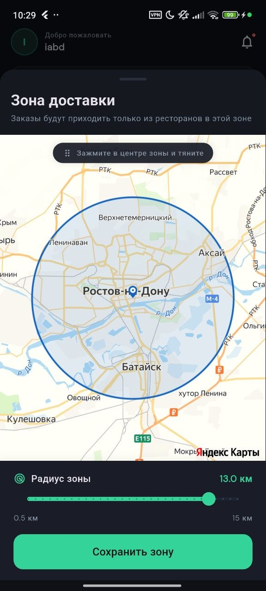
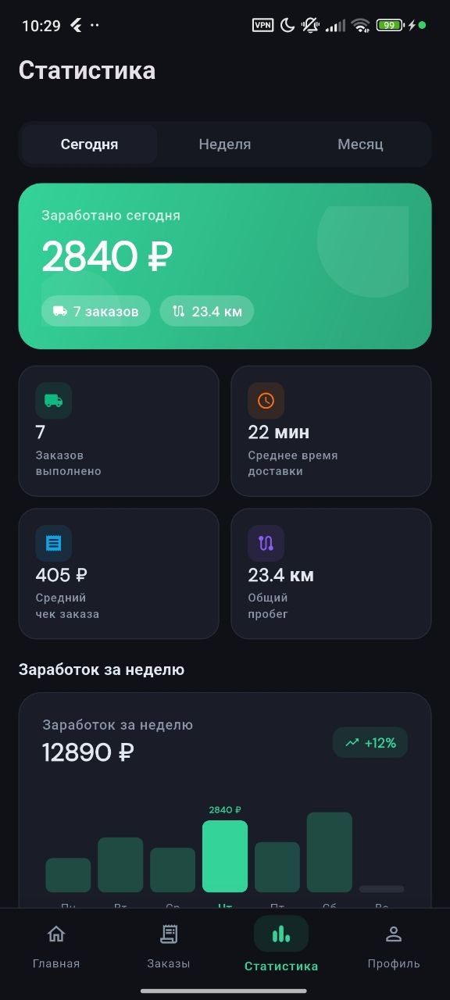
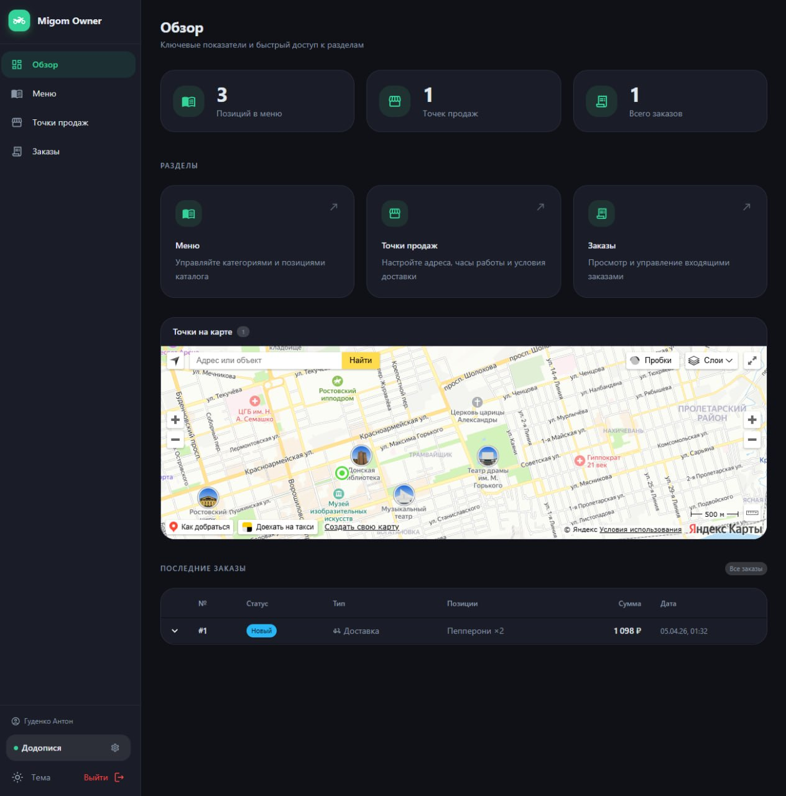
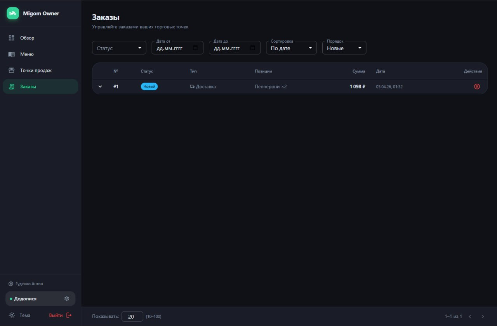

# Migom - агрегатор доставки еды

Платформа для заказа еды с доставкой. Покупатель оформляет заказ, система автоматически находит ближайшего свободного курьера и предлагает ему заказ через WebSocket.

## Архитектура

```
                        ┌─────────────────────────────┐
  Клиент (HTTP/WS)  ──► │         Nginx (80)          │
                        └──────┬──────────┬───────────┘
                               │          │
                  ┌────────────▼──┐   ┌───▼───────────────┐
                  │   business_   │   │   delivery_       │
                  │   service     │   │   service         │
                  │   :8000       │   │   :8001           │
                  │   (FastAPI)   │   │   (FastAPI)       │
                  └───────┬───────┘   └────────┬──────────┘
                          │                    │
                          └──────┬─────────────┘
                                 │
                    ┌────────────▼────────────┐
                    │         Kafka           │
                    └────────────┬────────────┘
                                 │
                    ┌────────────▼────────────┐
                    │   realtime_service      │
                    │   :8080  (Go)           │
                    │   WebSocket hub         │
                    └─────────────────────────┘
```

**Инфраструктура:** PostgreSQL 17 + PostGIS, Redis, Kafka (KRaft), MinIO, Nginx

## Сервисы

### `business_service` - Python / FastAPI
Управление бизнес-сущностями: пользователи, компании, каталог, торговые точки, отзывы, скидки, уведомления.

- Swagger: [http://localhost/business/docs](http://localhost/business/docs)
- Подробнее: [`backend/business_service/README.md`](backend/business_service/README.md)

### `delivery_service` - Python / FastAPI
Заказы, корзина, курьеры, смены. Push-система предложения заказов: при создании заказа система находит ближайшего свободного курьера и отправляет ему оффер на 30 секунд. При отказе или таймауте - предлагает следующему.

- Swagger: [http://localhost/delivery/docs](http://localhost/delivery/docs)
- Подробнее: [`backend/delivery_service/README.md`](backend/delivery_service/README.md)

### `realtime_service` - Go
WebSocket-хаб. Читает события из Kafka и доставляет их подключённым клиентам по роли: покупателям, менеджерам точек, курьерам. Только read-only - не пишет в БД.

- WebSocket: `ws://localhost/ws?token=<JWT>`
- Health: [http://localhost/realtime/health](http://localhost/realtime/health)
- Подробнее: [`backend/realtime_service/README.md`](backend/realtime_service/README.md)

## Скриншоты

### Мобильное приложение - покупатель

| | |
|:---:|:---:|
|  |  |
| **Главная страница** - лента ресторанов с фильтрацией по категориям (пицца, суши, бургеры), баннер акций и поиск | **Корзина** - позиции из нескольких ресторанов, выбор доставки или самовывоза, промокод, итоговая сумма |

### Мобильное приложение - курьер

| | | |
|:---:|:---:|:---:|
|  |  |  |
| **Главная** - управление сменой: начать/завершить смену, статус онлайн, выбор транспорта | **Зона доставки** - настройка радиуса приёма заказов на карте (Яндекс Карты) | **Статистика** - заработок за день/неделю/месяц, среднее время доставки, общий пробег |

### Веб-панель владельца (Migom Owner)

| | |
|:---:|:---:|
|  |  |
| **Обзор** - ключевые показатели (позиции меню, точки продаж, заказы), карта точек, последние заказы | **Заказы** - список заказов с фильтрацией по статусу и датам, управление входящими заказами |

## Быстрый старт

```bash
cd infra
docker compose up -d --build
```

После запуска применить миграции:

```bash
docker compose exec business_service alembic upgrade head
docker compose exec delivery_service alembic upgrade head
```

## Локальные порты

| Сервис | Порт |
|---|---|
| Nginx (API + WS) | `80` |
| PostgreSQL | `6432` |
| Redis | `7379` |
| MinIO API | `7000` |
| MinIO Console | `7001` |
| Kafka | `29092` |

## Kafka-топики

| Топик | Источник | Описание |
|---|---|---|
| `order.created` | delivery | Новый заказ создан |
| `order.status_updated` | delivery | Статус заказа изменился |
| `courier.assigned` | delivery | Курьер назначен на заказ |
| `courier.location_updated` | delivery | Геопозиция курьера обновлена |
| `courier.order_offer` | delivery | Push-оффер курьеру (30 сек на ответ) |

## Схема БД

Полная схема всех таблиц: [`full_db_shemas.dbml`](full_db_shemas.dbml)

## API для клиентов

Полная документация эндпоинтов по ролям (покупатель, курьер, владелец, менеджер): [`INSTRUCTION.md`](INSTRUCTION.md)


## Базовые данные для sql init

Все тестовые пользователи имеют пароль: **`password123`**

```sql
BEGIN;

-- 1. Роли (обязательно, без них регистрация не работает)
INSERT INTO roles (id, name, is_assignable) VALUES
  (1, 'customer',       true),
  (2, 'owner',          true),
  (3, 'courier',        true),
  (4, 'moderator',      false),
  (5, 'outlet_manager', true);

-- 2. Категории каталога
INSERT INTO catalog_categories (name, emoji, sort_order, is_active) VALUES
  ('Пицца',   '🍕', 1, true),
  ('Суши',    '🍣', 2, true),
  ('Бургеры', '🍔', 3, true),
  ('Напитки',  '🥤', 4, true);

-- 3. Тестовые пользователи (пароль: password123)
INSERT INTO users (id, role_id, email, password_hash, full_name, phone, is_active) VALUES
  (1, 4, 'admin@migom.ru',   '$2b$12$cPRU8OvAL5KP.0f1EDFwQuMw08HXCSc1iFtD3A4jb4qlgA5eehjUu', 'Модератор',          null,           true),
  (2, 2, 'owner@migom.ru',   '$2b$12$cPRU8OvAL5KP.0f1EDFwQuMw08HXCSc1iFtD3A4jb4qlgA5eehjUu', 'Иван Владелец',     '+79001110001', true),
  (3, 1, 'user@migom.ru',    '$2b$12$cPRU8OvAL5KP.0f1EDFwQuMw08HXCSc1iFtD3A4jb4qlgA5eehjUu', 'Алексей Покупатель','+79001110002', true),
  (4, 3, 'courier@migom.ru', '$2b$12$cPRU8OvAL5KP.0f1EDFwQuMw08HXCSc1iFtD3A4jb4qlgA5eehjUu', 'Пётр Курьер',       '+79001110003', true);
SELECT setval('users_id_seq', (SELECT MAX(id) FROM users));

-- 4. Компания (owner_id=2 - Иван Владелец)
INSERT INTO companies (id, owner_id, name, description, is_active, is_blocked) VALUES
  (1, 2, 'Пицца Рома', 'Итальянская пицца на дровяной печи', true, false);
SELECT setval('companies_id_seq', (SELECT MAX(id) FROM companies));

-- 5. Торговая точка (в центре Москвы)
INSERT INTO outlets (id, company_id, name, address, latitude, longitude, is_active, delivery_fee, min_order_price, opens_at, closes_at, timezone) VALUES
  (1, 1, 'Пицца Рома - Центр', 'ул. Тверская, 1', 55.757800, 37.614900, true, 150, 500, '09:00:00', '23:00:00', 'Europe/Moscow');
SELECT setval('outlets_id_seq', (SELECT MAX(id) FROM outlets));

-- 6. Товары в меню (company_id=1, category_id: 1=Пицца, 4=Напитки)
INSERT INTO catalog_items (company_id, category_id, name, description, price, is_active) VALUES
  (1, 1, 'Маргарита',      'Томат, моцарелла, базилик',          550.00, true),
  (1, 1, 'Пепперони',      'Томат, моцарелла, пепперони',         650.00, true),
  (1, 1, 'Четыре сыра',    'Моцарелла, гауда, пармезан, дор-блю', 720.00, true),
  (1, 4, 'Кока-Кола 0.5л', null,                                   120.00, true),
  (1, 4, 'Вода 0.5л',      null,                                    80.00, true);

-- 7. Адрес покупателя (user_id=3 - Алексей, рядом с точкой)
INSERT INTO customer_addresses (customer_id, label, address, latitude, longitude, is_active) VALUES
  (3, 'Дом', 'ул. Пушкина, 10', 55.762400, 37.618400, true);

-- 8. Способ оплаты покупателя
INSERT INTO customer_payment_methods (customer_id, type, title, provider, provider_token, is_default, is_active) VALUES
  (3, 'card', 'Visa *4242', 'mock', 'mock_token', true, true);

-- 9. Профиль курьера с геопозицией (рядом с точкой)
INSERT INTO couriers (user_id, is_blocked, radius_km, current_latitude, current_longitude) VALUES
  (4, false, 5, 55.758500, 37.615200);

-- 10. Активная смена курьера (courier_id=1 - первая запись в таблице couriers)
INSERT INTO shifts (courier_id, started_at, is_active) VALUES
  (1, now(), true);

COMMIT;
```

> После вставки можно сразу:
> 1. Залогиниться под покупателем `user@migom.ru` / `password123`
> 2. Добавить товар в корзину и оформить заказ с доставкой на адрес из п.7
> 3. Система автоматически предложит заказ курьеру `courier@migom.ru` через WebSocket

### Тестовые заказы

> Требует выполнения основного скрипта выше. Вставляет 5 заказов с разными статусами для проверки UI и фильтрации.

```sql
BEGIN;

-- Заказы: customer_id=3, company_id=1, outlet_id=1, courier_id=1 (couriers.id=1), address_id=1, payment_method_id=1
INSERT INTO orders (id, customer_id, company_id, outlet_id, courier_id, status, delivery_type, customer_address_id, total_price, comment, customer_payment_method_id, leave_at_door) VALUES
  (1, 3, 1, 1, null, 'new',              'delivery', 1, 700.00,  'Побыстрее пожалуйста', 1, false),
  (2, 3, 1, 1, 1,    'assigned',         'delivery', 1, 800.00,  null,                   1, true),
  (3, 3, 1, 1, 1,    'in_delivery',      'delivery', 1, 550.00,  'Домофон 42',           1, false),
  (4, 3, 1, 1, 1,    'delivered',        'delivery', 1, 1270.00, null,                   1, false),
  (5, 3, 1, 1, null, 'cancelled',        'delivery', 1, 650.00,  'Передумал',            1, false);
SELECT setval('orders_id_seq', (SELECT MAX(id) FROM orders));

-- Позиции заказов
INSERT INTO order_items (order_id, catalog_item_id, name, price, quantity) VALUES
  (1, 1, 'Маргарита',      550.00, 1),
  (1, 4, 'Кока-Кола 0.5л', 120.00, 1),
  (2, 2, 'Пепперони',      650.00, 1),
  (2, 5, 'Вода 0.5л',       80.00, 1),
  (3, 1, 'Маргарита',      550.00, 1),
  (4, 3, 'Четыре сыра',    720.00, 1),
  (4, 4, 'Кока-Кола 0.5л', 120.00, 1),
  (4, 5, 'Вода 0.5л',       80.00, 1),
  (4, 2, 'Пепперони',      350.00, 1),
  (5, 2, 'Пепперони',      650.00, 1);

-- История статусов
INSERT INTO order_status_history (order_id, status, changed_by) VALUES
  (1, 'new',         3),
  (2, 'new',         3),
  (2, 'assigned',    1),
  (3, 'new',         3),
  (3, 'assigned',    1),
  (3, 'assembling',  1),
  (3, 'ready_for_pickup', 1),
  (3, 'in_delivery', 4),
  (4, 'new',         3),
  (4, 'assigned',    1),
  (4, 'assembling',  1),
  (4, 'ready_for_pickup', 1),
  (4, 'in_delivery', 4),
  (4, 'delivered',   4),
  (5, 'new',         3),
  (5, 'cancelled',   3);

COMMIT;
```